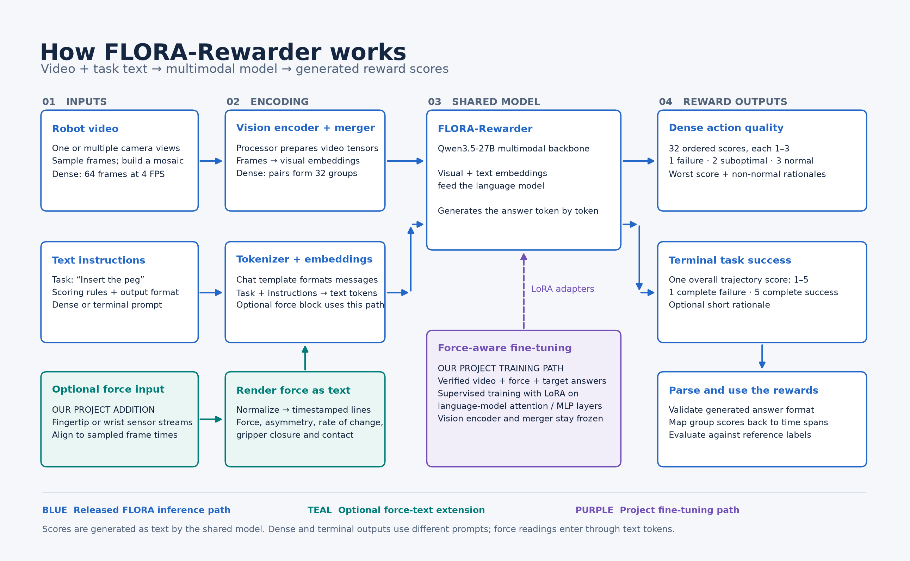

# tactile-flora

Fingertip force as text for a vision-language reward model. The repository adds a
force channel to NVIDIA's FLORA-Rewarder (a Qwen3.5-27B video reward model) by rendering the
sensor stream as a short text block in the prompt, fine-tunes the model with LoRA on grasp
clips, and evaluates it against the released model and a matched no-force fine-tune, on a
public tactile dataset and on a Baxter robot with home-built force-sensing fingertips.



## Results at a glance

| Setting | Released FLORA | Fine-tuned FLORA (video only) | Fine-tuned tactile FLORA |
|---|---:|---:|---:|
| HRDexDB, 251 held-out clips over 32 unseen objects: accuracy / AUROC | 66.5% / 0.600 | 76.5% / 0.830 | **79.3% / 0.873** |
| Baxter cube-pick rollouts, 10 clips, 2 successes: AUROC | 0.375 | 0.313 | **1.000** |

The ranking gain over the matched video-only fine-tune is +0.043 AUROC (object-level bootstrap
95% interval +0.001 to +0.080, p about 0.02). Shuffling the force blocks between clips removes it;
blanking the video leaves only the force's own moderate signal. On the robot, evaluated zero-shot,
the force block takes the ranking of the two successful grasps from below chance to perfect.
Full write-up: [writeup/tactile-flora-report.md](writeup/tactile-flora-report.md); the
side-by-side videos of every clip the tactile model wins are under `writeup/`.

## Repository map

| Path | What is there |
|---|---|
| `tactile_flora/` | The Python package: dataset adapters (`sources/`), the force channel (`force/`: resample, normalize, render, classifier), labels, verification and manifests, FLORA prompts, LoRA training, the evaluation harness with force ablations, video readers, and the Baxter sensor stack (`baxter/`: Teensy firmware, ROS node, recorder, calibration). |
| `configs/` | YAML for every stage: per-dataset source configs, `force.yaml`, `train/` (force and matched control), `eval/`, `baxter.yaml`. Pydantic-validated, unknown keys rejected. |
| `scripts/` | `tf` wrapper, dataset downloaders, and `cluster/` (the Slurm scripts that prepared, trained and evaluated every HRDexDB experiment and the Baxter rollouts). |
| `baxter/` | Robot-side code outside the package: `control/` (bring-up, hand-guided demo collection, tactile logging, dataset publishing, policy rollouts) and `act/` (training and publishing the ACT pick policy). |
| `writeup/` | Results: the experiment report, the HRDexDB comparison with 26 win videos, the Baxter rollout evaluation with 7 videos, a NeurIPS-style paper and a slide deck. |
| `docs/` | Specification, deviations from it, status log, experiment records with frozen plans, dataset and prompt research, hand-off instructions. |
| `tests/` | Unit tests per module and a pipeline smoke test, all on synthetic fixtures under `tests/fixtures/`; no GPU or dataset needed. |
| `data/` | Not in git. Raw datasets, verified artefacts, manifests, training runs and evaluation cells live here (`docs/pipeline.md` describes the layout). |

## Getting started

Python 3.11 and [uv](https://docs.astral.sh/uv/). The default dependencies are small; the
`[train]` extra pulls torch, transformers and peft and is only needed to run the 27B model.

```sh
git clone https://github.com/ogershony/tactile-flora.git && cd tactile-flora
uv python pin 3.11
uv sync --extra dev
uv run pytest -q                 # about 400 tests on fixtures, CPU only
uv run tf --help
```

Run the whole pipeline on synthetic data without a model: `uv run tf verify`, `tf manifest`,
`tf train --dry-run` and `tf eval run --backend stub` all work on the committed fixtures; the
stub backend is a deterministic fake model. The command reference, the data flow between
stages and the verified GPU environments are in [docs/pipeline.md](docs/pipeline.md).

## Reproducing the results

| Result | Where the steps are |
|---|---|
| HRDexDB: download, aligned clocks, frozen object-disjoint splits, train the force and control adapters, evaluate with ablations | [docs/experiments/hrdexdb-expanded-v2.md](docs/experiments/hrdexdb-expanded-v2.md) (data and splits), [docs/experiments/hrdexdb-expanded-v3.md](docs/experiments/hrdexdb-expanded-v3.md) (the corrected force representation that is the primary adapter), `scripts/cluster/prepare_hrdexdb_v3.py`, `launch_hrdexdb_v3.py` |
| HRDexDB comparison tables and win videos | [writeup/hrdexdb/README.md](writeup/hrdexdb/README.md), regenerated by `writeup/hrdexdb/make_videos.py` |
| Baxter rollouts: prepare the benchmark, run six cells, build the tables and videos | [docs/handoff/baxter-rollouts.md](docs/handoff/baxter-rollouts.md), `scripts/cluster/prepare_baxter_rollouts.py`, `evaluate_baxter_rollouts.py`, `writeup/baxter-rollouts/` |
| Baxter demos, ACT policy, live rollouts | [baxter/README.md](baxter/README.md) |

Datasets on the Hugging Face Hub: `HRDexDB/HRDexDB` (revision `98b8f8e`), `OG7407/baxter-cube-pick-left`
(50 hand-guided demos) and `OG7407/baxter-cube-pick-left-rollouts` (10 policy rollouts with tactile
data). The fine-tuned adapters are 609 MB PEFT directories kept outside git.

## Documentation

- [docs/README.md](docs/README.md): index of every document.
- [docs/spec.md](docs/spec.md): what was built and why; [docs/deviations.md](docs/deviations.md): where the code departs from it.
- [docs/status.md](docs/status.md): dated log of every run.
- [writeup/README.md](writeup/README.md): the report, paper, slides and per-experiment write-ups.

## Development

`uv run ruff check . && uv run ruff format --check . && uv run pyright && uv run pytest -q` is
what CI runs. `baxter/act` and `baxter/control` are folded in from other repositories and are
formatted but not linted. Every stage reads and writes files under `data/` with a documented
schema (`tactile_flora/schema.py`); no stage calls another stage's internals.
