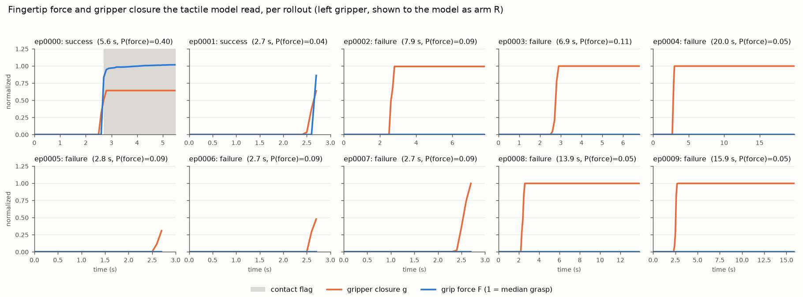

# Baseline, fine-tuned and fine-tuned tactile FLORA on ten Baxter cube-pick rollouts

Date: 2026-10-24. Branch `hrdexdb-v3-force-representation`. Data:
[`OG7407/baxter-cube-pick-left-rollouts`](https://huggingface.co/datasets/OG7407/baxter-cube-pick-left-rollouts)
(LeRobot v3, 10 episodes). Everything on disk is under
`data/acceptance/baxter-rollouts-v1/` (copy of the dataset, labels, manifest, normalization,
representation audit, the six evaluation cells and `evaluation-result.json`). The per-rollout
force figure is `baxter-rollouts/force_traces.png`.

## Which models

The request named "tactile-v4". No adapter by that name exists on the Hub (the OG7407 account
holds only the ACT policy), on Drive, or on disk, and the `plan-v4` branch's own write-up
(`writeup/v4-results.md` there) records that the v4 force and control adapters were lost with
the Colab runtime on 2026-10-24; only their HRDexDB results survived. The evaluation therefore
uses the fine-tuned adapters that do exist on disk, which are the same three models compared in
`writeup/comparison.md`:

| Name in this write-up | Checkpoint | Inputs | Training |
|---|---|---|---|
| Baseline FLORA | released `nvidia/Flora-Rewarder` | 64 video frames (96 px cells) | none |
| Fine-tuned FLORA | `hrdexdb-expanded-v2/runs/expanded-v2-control` | same video | LoRA on 350 HRDexDB grasp clips, force omitted |
| Fine-tuned tactile FLORA | `hrdexdb-expanded-v3/runs/expanded-v3-force` | same video + text block of normalized fingertip force, summary line, force-only classifier probability | same recipe and clips, force shown |

Both adapters were trained on a dexterous Inspire hand in the HRDexDB rig, never on Baxter, a
parallel gripper, FSR pads, or a head camera. This is a zero-shot transfer test for everything
except the released model's general pretraining.

## The data

Ten live rollouts of the ACT policy `OG7407/baxter-act-cube-left` on the task "pick up the red
cube" (left arm, 15 fps head and wrist cameras, 200 Hz fingertip FSR counts on the left
gripper's two pads; the right gripper has no sensors and reads zero throughout). Labels: the
operator's statement that episodes 0 and 1 succeeded and the other eight failed, written to
`raw/labels.json` and used in place of the recorder's labels. The recorder agrees on nine of
ten; it had auto-labelled episode 1 a failure because the policy was stopped by a joint-jump
guard at 2.7 s.

| Episode | Operator label | Recorder | Length | What the sensors saw |
|---|---|---|---:|---|
| ep0000 | success | success (operator, "picked") | 5.6 s | gripper stops at 0.37 (cube between the pads), force rises to the grasp level at 2.7 s and holds for 2.9 s while the fingertip lifts 20 cm |
| ep0001 | success | fail (auto, joint-jump stop) | 2.7 s | gripper closing on the cube; force appears 0.03 s before the last frame, in one sampled frame only |
| ep0002-0004, 0008, 0009 | failure | fail (auto) | 6.8-20 s | gripper closes fully on nothing (closure 1.0), zero force, arm lifts empty |
| ep0005-0007 | failure | fail (auto) | 2.7-2.8 s | stopped while closing, zero force |



So the force channel carries one clean success signature (ep0000), one marginal one (ep0001,
a single contact frame at the very end), and eight clips with no contact at all. The video
side is harder than it sounds at 96 px: the head camera looks down the arm, the cube is a few
pixels wide, and in the long failures the arm lifts and moves exactly as in a success, just
with nothing between the fingers.

## How the force was shown to the tactile model

The pipeline is the v3 one, unchanged: the same `force.yaml`, tokenizer budget, summary line
and force-only classifier (`hrdexdb-expanded-v3/config/force-classifier.json`, fitted on
HRDexDB training clips). Two things are specific to this data and are recorded in
`representation-audit.json`:

- **Normalization constants were fitted on these ten rollouts** (there is no training split):
  baseline 184 counts (the two pads' resting 92 + 92), median grasp 892.5 counts, contact
  threshold 219 counts (the 5% floor of the grasp excess, since the free-space signal has zero
  variance). One normalized unit is the grasp force in ep0000.
- **The left gripper is presented as arm `R`** (`baxter_rollouts_arm: R`). The HRDexDB
  adapters only ever saw `pad R` lines with `L none`; showing the same letter keeps the text
  in-distribution. Gripper closure is `(0.96 - position) / 0.92`, so a close stopped by the cube
  reads 0.64 and an empty close 1.0.

The force-only classifier, which is printed into the block, already gives a preview of what
the force can and cannot do here (success probability per episode):

| ep0000 | ep0001 | ep0002 | ep0003 | ep0004 | ep0005 | ep0006 | ep0007 | ep0008 | ep0009 |
|---:|---:|---:|---:|---:|---:|---:|---:|---:|---:|
| **0.40** | 0.04 | 0.09 | 0.11 | 0.05 | 0.09 | 0.09 | 0.09 | 0.05 | 0.05 |

It ranks ep0000 first and every failure below it, but puts ep0001 last: with a 0.13 s hold it
looks like a touch, not a grasp. AUROC 0.50 (one success ranked first, one last), 8/10 correct
at the 0.5 cut because it calls everything a failure.

## Results

RESULTS_PLACEHOLDER

## Reproduce

Step by step for a fresh machine: `docs/handoff/baxter-rollouts.md`. In short:

```sh
# dataset copy, labels, normalization, manifest, audit (CPU)
uv run python scripts/cluster/prepare_baxter_rollouts.py --dataset <download> \
  --base data/acceptance/baxter-rollouts-v1 --success-episodes 0,1 --arm R --cameras head \
  --tokenizer-json <flora snapshot>/tokenizer.json
# six cells (released omitted/real, control omitted, force real/shuffled/omitted), ~76 GB GPU
uv run python scripts/cluster/evaluate_baxter_rollouts.py --base data/acceptance/baxter-rollouts-v1 \
  --model-id <flora snapshot> --control-adapter <expanded-v2-control>/adapter \
  --force-adapter <expanded-v3-force>/adapter --backend hf
```

The adapter is `tactile_flora/sources/baxter_rollouts.py` (registered as `baxter_rollouts`,
eval only); `--backend stub` on the evaluation script runs the whole pipeline on a CPU for
wiring checks. The force config and classifier are `configs/eval/baxter_rollouts/`.
