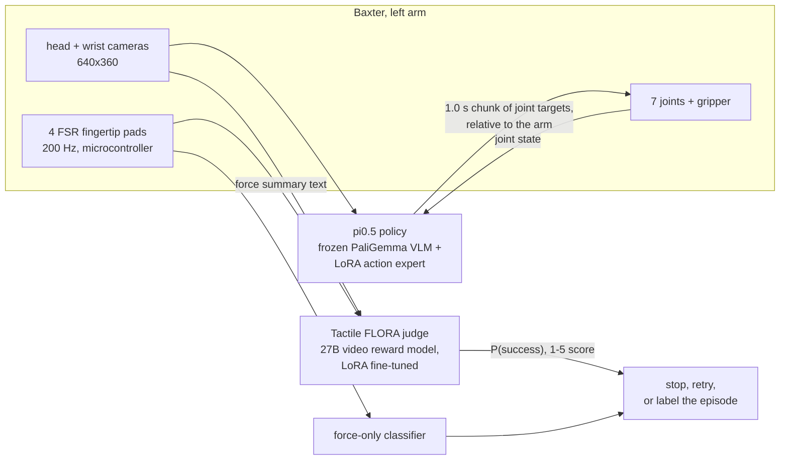
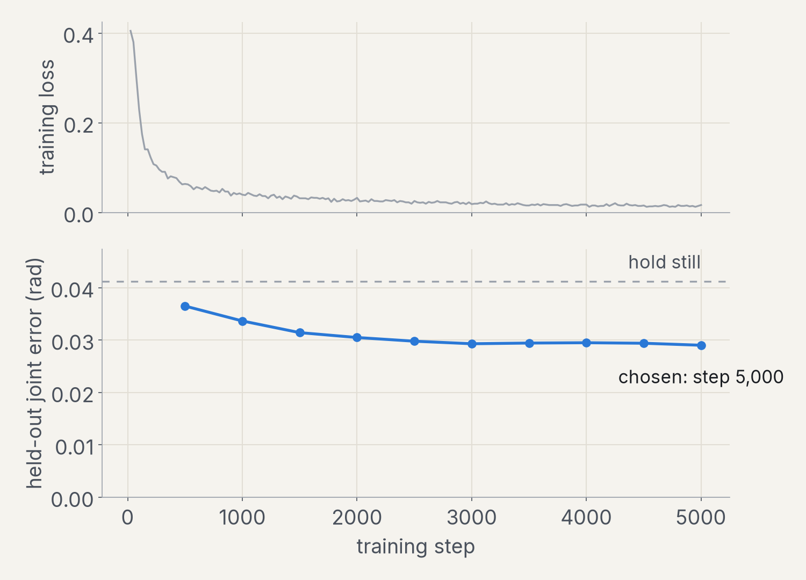
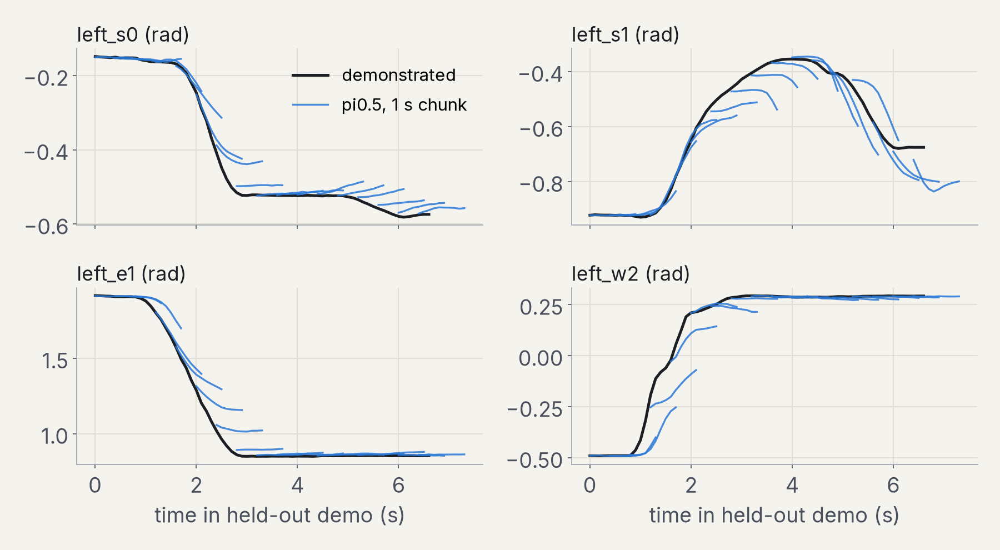

# Tactile FLORA: robots that know when they've failed

GPT-6 Astra Robotics Hardware Hackathon, 2026-10-24. Repository: [ogershony/tactile-flora](https://github.com/ogershony/tactile-flora).

> Video: [`video/tactile_flora_hackathon.mp4`](video/tactile_flora_hackathon.mp4) &middot; Full reward-model results: [`../v4-results.md`](../v4-results.md) &middot; Earlier tactile study: [`../comparison.md`](../comparison.md)

## In one minute

A robot that drops a part, misses a grasp or stalls does not know it. Today a person watches the
video and decides. We built the three pieces a robot needs to check its own work, and measured each
one on data it never trained on.

1. **Touch on a real robot.** Force-sensitive pads on our Baxter's gripper fingers, read at 200 Hz
   and recorded frame-aligned with the head and wrist cameras into LeRobot datasets, together with
   live policy rollouts and operator success labels.
2. **A failure judge that works.** We fine-tuned NVIDIA's FLORA-Rewarder, a 27B video reward model.
   On 428 locked test trials over 59 objects it never saw, failure-detection AUROC rises from
   **0.783 to 0.956**, and the share of failures it catches at its own threshold rises from
   **34% to 84%** while it still passes 98% of successes. On a second robot dataset (REASSEMBLE)
   AUROC rises from 0.648 to 0.919.
3. **A policy that respects the arm.** Our first Baxter policy (ACT) succeeded in 1 of 10 live
   runs; 8 of the 9 failures were safety aborts because a new action chunk started more than
   0.25 rad away from where the arm actually was. We fine-tuned Physical Intelligence's pi0.5 on the
   same 18 demonstrations overnight on a laptop GPU, predicting motion relative to the arm's current
   joints so that every chunk starts where the arm is. On two held-out demonstrations its 1.0 s chunks
   are off by 0.030 rad on average, 28% less than holding still, and none of 547 predicted chunks
   (141 held-out frames, 406 frames from the live ACT rollouts) starts more than 0.25 rad from the arm.

The finding we did not expect, and the one we think matters most for anyone adding touch to a
robot: **force helps a video judge only when the video is poor.** At low resolution, adding the
force signal raised AUROC by 0.043 (p about 0.02). At FLORA's native resolution it adds nothing
measurable (-0.008, 95% CI [-0.023, +0.004]), because the fine-tuned video model is already right
on almost every clip. Touch earns its place where cameras cannot see: occlusion, low light,
in-hand slip, and cheap low-resolution cameras. A force-only classifier, with no video at all,
already reaches AUROC 0.75 to 0.82.

## The system

## 1. Touch on Baxter

- Four force-sensitive resistor pads (channels L_a, L_b, R_a, R_b) on the parallel gripper,
  sampled at 200 Hz by an ESP32 over WiFi UDP or by a USB-serial microcontroller, with a ROS1 node,
  a recorder and a converter to LeRobot v3 (`tactile_flora/baxter`, branch `baxter-fsr`).
- Ten live ACT rollouts were recorded with tactile on 2026-10-24
  ([OG7407/baxter-cube-pick-left-rollouts](https://huggingface.co/datasets/OG7407/baxter-cube-pick-left-rollouts)).
  At rest the pads read 92 counts; during the successful grasp they reach 425 and 482 counts.
  The runner's automatic success check agreed with the operator's label on all 10 runs.
- The pads are not yet force-calibrated (we report ADC counts, not newtons). The calibration tool
  and a per-pad fit exist; the sensor's R(F) curve still has to be measured with reference weights.

## 2. The failure judge: Tactile FLORA

FLORA-Rewarder (NVIDIA, Qwen3.5 27B) watches a robot video and returns a 1 to 5 success score.
Out of the box it misses most failures in dexterous manipulation. We fine-tuned it with LoRA
(rank 16, 1 epoch) on 1,811 labelled clips from three public datasets: 618 HRDexDB
dexterous-hand trials, 1,146 REASSEMBLE assembly segments and 47 PHANTOM episodes, 598 of them
failures. We trained two adapters that are identical except for one thing: the **force adapter**
also reads a short text block summarising fingertip force; the **control adapter** never sees force.

Everything was pre-registered before the test sets were opened: object-disjoint splits, a locked
test set, 10,000-sample cluster bootstrap over objects, DeLong tests, Holm correction across three
test sets, and thresholds chosen only on the dev split.

| HRDexDB locked test (428 trials, 151 failures, 59 unseen objects) | AUROC [95% CI] | Failures caught | Successes passed |
|---|---|---:|---:|
| Released FLORA | 0.783 [0.739, 0.827] | 34% | 100% |
| Released FLORA + force text (no training) | 0.838 [0.787, 0.881] | 46% | 100% |
| **Fine-tuned, force adapter** | **0.956 [0.932, 0.975]** | **84%** | **98%** |
| **Fine-tuned, control adapter (no force)** | **0.964 [0.943, 0.980]** | **85%** | **98%** |
| Force-only classifier (no video) | 0.751 [0.691, 0.799] | 36% | 92% |

- Fine-tuning effect: +0.173 AUROC [+0.131, +0.215], Holm-corrected p = 1.5e-11. At a fixed 90%
  success recall, failure recall goes from 64% to 88%.
- REASSEMBLE (399 segments, a different robot and task family): 0.648 to 0.919 (force) and 0.940
  (control), +0.271, Holm p = 1.5e-20. PHANTOM's 40 test episodes are too few to separate the models.
- What force adds once the video is good: -0.008 AUROC on HRDexDB, -0.021 on REASSEMBLE. The
  adapter does read the force block (shuffling it costs 0.028 AUROC on REASSEMBLE, p = 0.04),
  but the video already carries the answer.
- What fine-tuning costs: on 500 general RoboRewardBench clips the ranking survives (AUROC 0.934
  to 0.92) but the graded 1 to 5 scale collapses to pass/fail (MAE 0.40 to 0.97).

## 3. The policy: pi0.5 on Baxter, trained overnight on a laptop

Data: [OG7407/baxter-cube-pick-left-v0](https://huggingface.co/datasets/OG7407/baxter-cube-pick-left-v0),
18 kinesthetic demonstrations of "pick up the red cube" (a person guides the arm by hand),
1,622 frames at 10 Hz, 2.7 minutes in total. Demonstrations 5 and 14 are held out for evaluation.

Choices, and why:

- **Relative joint targets.** The model predicts each 1.0 s chunk as offsets from the arm's current
  joints (gripper absolute), with normalization statistics recomputed on those offsets. ACT's
  absolute targets drifted from the arm and tripped the runner's 0.25 rad jump check in 8 of 9
  failed runs; an offset chunk starts at the arm by construction.
- **Frozen VLM, LoRA on the action expert.** pi0.5 was pretrained with knowledge insulation, which
  stops action gradients from reaching the vision-language backbone. We keep the PaliGemma VLM
  frozen and train rank-32 LoRA on every linear layer of the 300M flow-matching action expert and
  its action and time projections: 14.1M trainable parameters, 160 MB per checkpoint.
- **Frozen-prefix training step.** LeRobot's stock training pass runs images, text and actions
  through one joint attention, so autograd backpropagates through the 2B language model even when
  it is frozen: batch 32 does not fit in 24 GB. Because pi0.5's prefix never attends to the action
  tokens, we compute the prefix key/value cache once without gradients, exactly as inference does,
  and backpropagate only through the expert. On the same batch the loss matches the stock pass to
  0.09% and every LoRA gradient matches with cosine similarity of at least 0.994, at 9.5 GiB peak
  memory instead of 15.1 GiB (batch 2). At batch 32 a step takes 2.4 s on an RTX 5090 laptop GPU
  capped at 95 W.

Held-out results (step 5,000 of 5,000; demonstrations 5 and 14, 141 frames, never trained on; open loop):

| Metric | pi0.5 | Hold still (no model) |
|---|---:|---:|
| Mean joint error over the next 1.0 s | **0.030 rad** | 0.042 rad |
| Joint error of the first step (the next command) | 0.007 rad | |
| Joint error 1.0 s ahead | 0.050 rad | |
| Gripper error (0 to 1 scale of the demos) | 0.061 | 0.094 |
| Chunks starting more than 0.25 rad from the arm | **0 of 141** | |
| Same check on frames of the 10 live ACT rollouts | **0 of 406** (mean largest first-step offset 0.031 rad) | |

Training: 5,000 steps at batch 32 (108 epochs of the 16 training demonstrations) in 3 h 23 min.
Held-out error falls from 0.036 rad at step 500 to 0.029 rad at step 3,000 and stays flat to 5,000
(every 2nd frame, one fixed noise seed), so the longer run did not overfit the held-out demos.

The chunks track the demonstration closely once a motion is under way and lag at its onset (left_w2
at 1 to 2 s): the model sees one frame, so it cannot know exactly when the demonstrator started
moving. These are open-loop numbers; closed-loop success on the robot is the next measurement.

## Why it matters

- **Data collection that labels itself.** Every teleoperated or autonomous episode can be scored
  automatically; a judge that catches 84% of failures while passing 98% of successes turns hours of
  video review into a short audit of the flagged clips.
- **Safety and retries.** A judge that runs after each attempt lets a robot stop or retry instead of
  continuing on a dropped part. The force-only classifier runs on a 200 Hz signal from a
  microcontroller and needs no GPU.
- **Reward for learning.** The same score is a reward signal for policy improvement, and our
  fine-tune shows a public 27B reward model can be adapted to a new robot domain with about 1,800
  labelled clips.
- **A design rule for touch.** Our matched-control result tells hardware teams where fingertip
  sensing pays: where the cameras are weak, not where they are already decisive.

## What is new here

- A matched-control test of adding touch to a video reward model: same data, seed and batch order
  with and without force, plus shuffled-force and force-removed probes, on a locked,
  object-disjoint test set.
- The resolution interaction: the same force signal that helps a vision-starved judge (+0.043)
  adds nothing at native resolution, reconciling our two studies.
- A frozen-prefix training step that makes pi0.5 fine-tuning fit on a 24 GB laptop GPU, with a
  numerical equivalence check against the stock implementation.
- A full sense-act-judge stack on a Baxter research robot: FSR pads, LeRobot recording, a VLA
  policy and a VLM judge.

## Limitations

- The judge was trained and tested on public datasets (dexterous hands, assembly), not yet on
  Baxter episodes; 10 Baxter rollouts are too few to report a judge accuracy on our own robot.
- One training seed per adapter is reported; a second seed was still running at submission.
- The kinesthetic demonstrations show a human arm in the head camera that the policy will not see
  at deployment, and 18 demonstrations from one start pose cover a narrow set of cube positions.
- pi0.5 numbers are open-loop on held-out demonstrations, not closed-loop success on the robot.
- Fine-tuning trades away FLORA's graded progress scale (it answers pass/fail).
- FSR pads are uncalibrated, and two of the four channels read zero throughout the rollouts.

## Reproduce

- Reward model: `docs/v4/plan.md` (run log), `scripts/v4/` (data, training, evaluation, analysis),
  `docs/v4/results/` (locked summaries and per-clip scores for every model and test set).
- pi0.5 on Baxter: `vla/pi05_baxter/README.md` (environment, dataset preparation, training,
  evaluation; LeRobot 0.6.1, one 24 GB GPU).
- Baxter tactile stack: branch `baxter-fsr`, `baxter_fsr/README.md`.

## Team

Oren Gershony and Kenan Blair, with the robotics club's Baxter crew.
