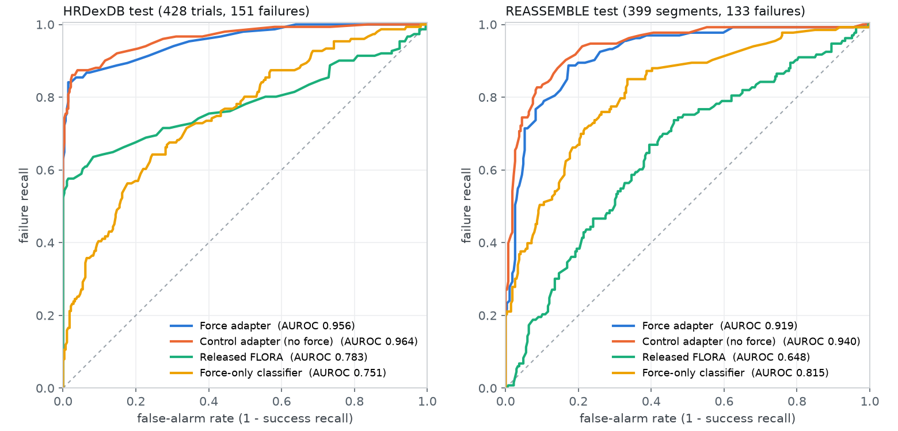

# v4: FLORA at its native input, fine-tuned with and without force, on locked test sets

Date: 2026-10-24. Branch `plan-v4`. Plan of record and full run log: `docs/v4/plan.md`. Every
number here comes from `scripts/v4/analyze.py` run once on the locked test cells
(`docs/v4/results/summary_*.txt`, transcribed from the runtime), or is recomputed from the per-clip
export in `docs/v4/results/` where marked. A second training seed of both arms is running; its rows
will be added when it finishes.

## Summary

- Fine-tuning FLORA on its own native-resolution input lifts failure detection on the locked
  HRDexDB test from AUROC 0.783 to 0.956 (force adapter) and 0.964 (control adapter, no force).
  Failure recall at the model's own threshold goes from 0.344 to 0.841, and at 90% success
  recall from 0.636 to 0.881. REASSEMBLE shows the same kind of gain (0.648 to 0.919 / 0.940).
- The force text adds nothing measurable once the model is fine-tuned on native video. Force
  adapter minus matched control: HRDexDB -0.008 AUROC [-0.023, +0.004], REASSEMBLE -0.021
  [-0.042, -0.002].
- This reverses the v3 finding (`writeup/comparison.md`: force +0.043 pooled AUROC over the
  video-only model, p about 0.02). The likely reason: every model before v4, the released
  baseline included, saw each camera as a 96x72 thumbnail. At FLORA's native input the video is
  decisive on most clips, and v3 found force helps only where video is unsure.
- On general video (RoboRewardBench, 500 clips, no force) the adapters keep their ranking
  (AUROC 0.934 to 0.92) but lose the graded 1-5 scale (MAE 0.40 to 0.97): they answer only 1 or 5.

Curves sweep the E[s] cut (failure if E[s] <= cut). They are drawn from the per-clip export, which
rounds E[s] to 0.01; the AUROCs in the legend are the full-precision values from the analysis.

## What changed from v3

| | v3 (`writeup/comparison.md`) | v4 (this write-up) |
|---|---|---|
| Video input | one scene camera in a 96 px cell (96x72 padded to 96x96) | the released FLORA collage: 2 views x 384x288, 64 frames (cameras 22641005 + 22684737, chosen on TRAIN by a rule fixed in advance) |
| Hands | inspire_dftp | inspire_dftp + inspire_f1 (tactile decoded, per-hand normalization) |
| Training data | 350 HRDexDB clips | 618 HRDexDB trials + 1,146 REASSEMBLE segments + 47 PHANTOM episodes (1,811 rows, 598 failures) |
| Recipe | LoRA r32, lr 2e-5, 4 epochs, rationale template + score | LoRA r16, lr 1e-4, 1 epoch, score-only target under the released score-only prompt, failure weight 2.0 |
| Force block | tared force lines, summary line, classifier probability | compact block: code summary + force-only classifier P(success) (frame lines dropped) |
| Control | the v2 control adapter (not retrained) | matched control: same data, seed and batch order, force omitted |
| Held-out | dev 136 / test 115 clips (DFTP, 16 + 16 objects) | dev 149 / test 428 trials (both hands, 22 + 59 objects), object-disjoint across hands |
| Statistics | object bootstrap, McNemar | pre-registered: 10,000 cluster-bootstrap resamples, DeLong, Holm over three test sets, thresholds only from dev |

## HRDexDB test (locked, 428 trials, 151 failures)

AUROC treats failure as positive and ranks by -E[s]; 95% intervals resample objects. BA, failure
recall (FR) and success recall (SR) are at the model's own hard score (score <= 2 is failure, no
tuning). FR@SR90 is failure recall at 90% success recall.

| Model | AUROC [95% CI] | AUPRC | BA | FR | SR | FR@SR90 |
|---|---|---:|---:|---:|---:|---:|
| Released FLORA | 0.783 [0.739, 0.827] | 0.797 | 0.672 | 0.344 | 1.000 | 0.636 |
| Released FLORA + force text | 0.838 [0.787, 0.881] | 0.831 | 0.732 | 0.464 | 1.000 | 0.662 |
| **Control adapter (no force)** | **0.964 [0.943, 0.980]** | 0.955 | 0.913 | 0.848 | 0.978 | 0.881 |
| **Force adapter** | **0.956 [0.932, 0.975]** | 0.947 | 0.912 | 0.841 | 0.982 | 0.881 |
| Force adapter, force removed | 0.963 [0.943, 0.978] | 0.951 | 0.907 | 0.828 | 0.986 | 0.868 |
| Force adapter, force shuffled | 0.958 [0.930, 0.976] | 0.950 | 0.917 | 0.848 | 0.986 | 0.868 |
| Force-only classifier | 0.751 [0.691, 0.799] | 0.657 | 0.642 | 0.364 | 0.921 | 0.404 |
| Late fusion: released + classifier | 0.829 [0.776, 0.870] | 0.791 | | | | 0.596 |
| Late fusion: control + classifier | 0.916 [0.885, 0.943] | 0.889 | | | | 0.755 |
| Hand prior | 0.547 [0.475, 0.610] | 0.377 | 0.500 | 0.000 | 1.000 | 0.000 |

Late fusion is the mean normalized risk rank of the video model and the classifier, with no
fitted parameter (added before any force-adapter result was read).

Paired comparisons on the same clips:

| Comparison | dAUROC [95% CI] | p (DeLong) | dBA | dFR |
|---|---|---:|---:|---:|
| Force adapter vs released (primary) | +0.173 [+0.131, +0.215] | 7.6e-12 (Holm 1.5e-11) | +0.239 | +0.497 |
| Control vs released (fine-tuning alone) | +0.181 [+0.138, +0.224] | 3.6e-13 | +0.241 | +0.503 |
| Force adapter vs control (what force adds) | -0.008 [-0.023, +0.004] | 0.21 | -0.002 | -0.007 |
| Real vs shuffled force | -0.001 [-0.011, +0.010] | 0.82 | -0.005 | -0.007 |
| Real force vs force removed | -0.006 [-0.018, +0.003] | 0.21 | +0.005 | +0.013 |
| Force adapter vs force-only classifier | +0.206 [+0.164, +0.256] | 4.0e-20 | +0.269 | +0.477 |
| Force adapter vs late fusion (control + classifier) | +0.040 [+0.025, +0.058] | 1.2e-05 | | |
| Released + force text vs released (no training) | +0.055 [+0.025, +0.087] | 5.5e-04 | +0.060 | +0.119 |

At the E[s] cut chosen on dev, the force adapter reaches BA 0.909 (FR 0.854, SR 0.964), the
control 0.886 (FR 0.921, SR 0.852), released FLORA 0.775 (FR 0.636, SR 0.913). Restricting to
trials whose video covers the sensor timeline within 0.5 s (fixed in advance) changes nothing:
primary +0.174, force vs control -0.009.

Per hand (AUROC): released 0.759 (DFTP) / 0.874 (F1); control 0.959 / 0.976; force adapter
0.941 / 0.981; force-only classifier 0.783 / 0.708.

## Other test sets

| Test set | Released | Control | Force adapter | Primary dAUROC [95% CI], Holm p | Force vs control |
|---|---:|---:|---:|---|---|
| REASSEMBLE (399 segments, 133 failures) | 0.648 | 0.940 | 0.919 | +0.271 [+0.212, +0.329], 1.5e-20 | -0.021 [-0.042, -0.002] |
| PHANTOM (40 episodes, 20 failures) | 0.512 | 0.662 | 0.585 | +0.073 [-0.038, +0.188], 0.20 | -0.078 [-0.251, +0.098] |

On REASSEMBLE the force adapter does read the block (real vs shuffled +0.028 [+0.000, +0.059],
p = 0.04), yet the control trained without it is better. Failure recall at 90% success recall
goes from 0.195 (released) to 0.782 (force) and 0.835 (control). PHANTOM's 40 clips cannot
separate anything.

RoboRewardBench (500 clips, camera only, graded 1-5 progress): released FLORA MAE 0.40 (40.0 x 100,
the FLORA paper's full-benchmark figure, an independent check on our harness), control 0.98, force
adapter 0.96; AUROC with a true score <= 2 as failure 0.934 / 0.916 / 0.920.

## Compared with v3 (`writeup/comparison.md`)

Splits differ (v3: 115 DFTP test clips over 16 objects; v4: 428 trials over 59 objects, both hands),
so the absolute numbers are indicative, not a paired comparison. DFTP-only v4 numbers are recomputed
from the per-clip export; accuracy is v3's metric (success if E[s] >= 4.0).

| DFTP test | Released AUROC | Video-only fine-tune: AUROC / accuracy | Force fine-tune: AUROC / accuracy | Force minus video-only (AUROC) |
|---|---:|---:|---:|---:|
| v3 (115 clips) | 0.593 | 0.733 / 69.6% | 0.800 / 72.2% | +0.067 (pooled with dev: +0.043, p about 0.02) |
| v4 (215 trials) | 0.759 | 0.959 / 88.8% | 0.939 / 89.8% | -0.020 |

Where the two agree:

- **Force alone has a ceiling near 0.75-0.82 AUROC.** v3 measured 0.76 to 0.82 for every
  force-only probe. The v4 classifier gets 0.751 on HRDexDB test (0.783 DFTP) and 0.815 on
  REASSEMBLE.
- **Untrained FLORA gains from the force text.** v3: test AUROC 0.593 to 0.647. v4: 0.783 to
  0.838 on HRDexDB and 0.648 to 0.746 on REASSEMBLE.
- **The fine-tuned force model reads the block.** v3's shuffled donors cost 25 paired clips
  (p = 0.009). In v4 shuffling costs 0.028 AUROC on REASSEMBLE (p = 0.04), but nothing on
  HRDexDB.
- **Force helps where video is unsure.** v3 found the gain concentrated on clips within 0.75 of
  the threshold. At native resolution the fine-tuned models answer 1 or 5 on almost every clip,
  so there is little left for force to rescue.

Where they disagree, and the likely reason:

- **The force gain disappears.** It goes from +0.043 pooled (v3) to -0.008 [-0.023, +0.004] on
  HRDexDB and -0.021 on REASSEMBLE (v4).
- **The input is the largest difference.** Released FLORA zero-shot on the same 299 training
  trials goes 0.642 (96 px) to 0.723 (native, one view) to 0.745 (native, two views), from the
  camera study in `docs/v4/plan.md`.
- **v4 also changed data volume, recipe and control.** It has 5x the training rows, a
  score-only recipe and a matched control rather than the v2 one. This experiment does not
  separate those factors: there is no 96 px fine-tune in v4.
- **The stacking idea did not carry over.** v3's logistic stack of VLM scores and the classifier
  lifted test accuracy, but at native resolution the parameter-free fusion of control and
  classifier (0.916) is below the control alone (0.964). The classifier dilutes a strong video
  model.

## Caveats

- **Single seed so far.** The seed-1 replicate of both arms is training. After a full environment
  rebuild on a new runtime, the seed-1 force run's first loss matches the first runtime's to the
  sixth digit (0.517989).
- **Graded scale lost on general data.** Losing the 1-5 scale on RoboRewardBench would draw the
  first reviewer objection. The fix is to mix graded data, such as RoboReward's training split,
  into fine-tuning.
- **Label audit pending.** On dev, the force adapter's 7 missed failures cluster on three objects,
  and the force classifier also called most of them successes. The blind label audit of the test
  errors is still to do.
- **PHANTOM is too small** to say anything (40 clips).
- **The trained adapters were lost.** They lived only on the Colab runtime, which ended on
  2026-10-24; the results and per-clip scores are in `docs/v4/results/`.

## Reproduce

- **Split, prep and manifests:** `configs/v4/hrdexdb_split.json` (frozen 2026-10-22, object hash),
  `scripts/v4/prepare_hrdexdb_v4.py` and `scripts/v4/build_v4_manifests.py`.
- **Frames:** `scripts/v4/hrdexdb_fetch_render.py` renders the frames.
- **Camera study and parity:** `scripts/v4/flora_native_eval.py`, `camera_study_jobs.py`,
  `choose_views.py`, `parity_check.py`.
- **Training:** `configs/train/v4_force.yaml` and `v4_control.yaml` (identical except
  `force_mode`), via `tf train`.
- **Evaluation:** `tf eval grid --backend vllm` with `configs/eval/benchmarks.v4.yaml` and
  `configs/force.v4.yaml`, driven by the stage scripts in `scripts/v4/colab/`.
- **Analysis:** `scripts/v4/analyze.py data/eval data/hrdexdb_v4_audit.json`. Baselines come from
  `scripts/v4/classifier_cells.py`; the per-clip export from `scripts/v4/export_scores.py --pack`,
  decoded by `scripts/v4/decode_export.py`.
